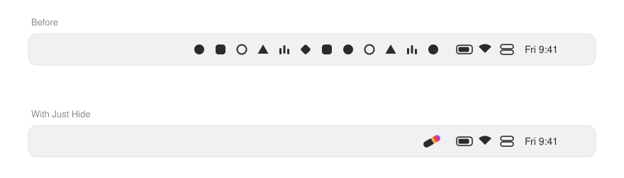

<p align="center">
  
</p>

<h1 align="center">Just Hide</h1>

<p align="center">One click, and the menu bar icons you don't need are gone.</p>

<p align="center">
  <a href="https://github.com/idkatanica/just-hide/releases/latest"></a>
  
  
</p>

<br>

<p align="center">
  <picture>
    <source media="(prefers-color-scheme: dark)" srcset="assets/menu-bar-dark.svg">
    
  </picture>
</p>

## Install

```sh
curl -fsSL https://raw.githubusercontent.com/idkatanica/just-hide/main/install.sh | bash
```

Puts Just Hide in Applications after checking the download. Run it again to update. Apple Silicon and Intel.

## What it does

- **Click the capsule** to hide icons; click again to bring them back in place. A shortcut works too.
- **Choose what hides** in Settings: drag an icon across the capsule in a live copy of your menu bar.
- **Hides again on its own** after a delay you pick, never while you're using a menu.

## Good to know

- Allow **Accessibility** when asked: it lets Just Hide see your icons. **Screen Recording** is optional and only shows their pictures in Settings. Nothing leaves your Mac.
- On macOS 27, all icons of an app hide together, and Focus hides along with them.
- Not notarized by Apple. If macOS ever blocks it, use **System Settings › Privacy & Security › Open Anyway**.

<details>
<summary>Remove Just Hide</summary>

```sh
curl -fsSL https://raw.githubusercontent.com/idkatanica/just-hide/main/install.sh | bash -s -- --uninstall
```

</details>

## Feedback

[Report a bug](https://github.com/idkatanica/just-hide/issues/new?template=bug.yml) · [Suggest a feature](https://github.com/idkatanica/just-hide/issues/new?template=feature.yml)

## License

Free to use under the [Just Hide Freeware License](LICENSE).
